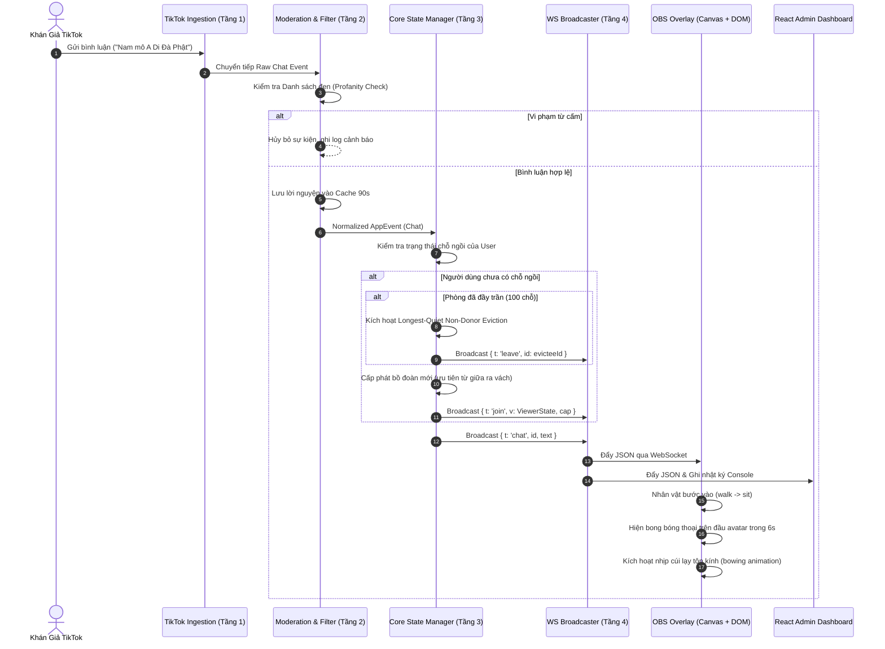

# KIẾN TRÚC HỆ THỐNG: CHÁNH ĐIỆN TỊNH TÂM

## System Architecture Breakdown — TikTok Interactive Livestreaming Platform

---

## 1. TỔNG QUAN & MỤC TIÊU HỆ THỐNG (EXECUTIVE SUMMARY)

**"Chánh Điện Tịnh Tâm"** là giải pháp phần mềm livestream tương tác thời gian thực (Real-time Interactive Livestreaming Overlay) vận hành trên nền tảng TikTok LIVE kết hợp với OBS Studio / TikTok LIVE Studio. Hệ thống số hóa không gian chánh điện Phật giáo truyền thống Việt Nam thành một môi trường thiền định tương tác 2.5D trang nghiêm, tôn kính:

- **Khán giả tương tác trực tiếp**: Khi người xem bình luận, thả tim hoặc cúng dường quà tặng (gifts), hệ thống sẽ phản chiếu hành vi đó lên không gian chánh điện ảo: người xem được cấp bồ đoàn tọa thiền, avatar hiển thị trang trọng, bình luận nổi dưới dạng bong bóng thoại, quà tặng kích hoạt nghi lễ bái lạy (prostration), xướng tên hồi hướng công đức bằng giọng đọc tiếng Việt truyền cảm (Edge TTS), thỉnh chuông chùa ngân vang và gõ mõ định tâm.
- **Tách biệt kiến trúc 4 tầng (4-Tier Decoupled Architecture)**: Thay thế hoàn toàn mô hình nguyên khối (monolithic) của các mã nguồn tham chiếu cũ, phân định ranh giới rõ ràng giữa Tầng Thu nhận (Ingestion), Tầng Chuẩn hóa & Lọc (Normalizer & Moderation), Tầng Quản lý Trạng thái (Core State Manager), và Tầng Phát sóng (WebSocket Broadcaster).
- **Đồ họa lai OBS CEF (Hybrid Rendering Engine)**: Kết hợp Canvas 2D khóa cứng 60fps (xử lý phối cảnh 2.5D, chuyển động nhân vật, hệ thống hạt khói/hào quang) với DOM/CSS Layer (đảm bảo độ sắc nét typography tiếng Việt mạ vàng kim cho bảng công đức và hoành phi).
- **Tối ưu hóa tài nguyên & Độ bền bỉ 24/7**: Loại bỏ hoàn toàn nút bật tiếng thủ công (unmute overlay), thay thế cơ chế ghi file TTS ra đĩa SSD bằng In-Memory Buffer / Data URI streaming qua WebSocket, tối ưu bộ nhớ dưới 120MB, loại bỏ triệt để đoạn mã ẩn chèn watermark từ kho tham chiếu gốc.

---

## 2. KIẾN TRÚC TỔNG THỂ 4 TẦNG (4-TIER DECOUPLED ARCHITECTURE)

```
┌─────────────────────────────────────────────────────────────────────────────────────────────┐
│                                 TIKTOK LIVE STREAM (Room)                                   │
└──────────────────────────────────────────────┬──────────────────────────────────────────────┘
                                               │ Webcast Protobuf Push over Signed WebSocket
                                               ▼
┌─────────────────────────────────────────────────────────────────────────────────────────────┐
│ TẦNG 1: EVENT INGESTION LAYER (Thu Nhận Sự Kiện Đa Nguồn)                                   │
│  ├── TikTokLiveAdapter (tiktok-live-connector v2.5+, EulerStream SDK signature,              │
│  │   residential proxy qua hpagent, xác thực session cookie sessionId + tt-target-idc)      │
│  ├── MockBotSimulatorAdapter (Bộ sinh bot tự động: 1-100 bots, bình luận, thả tim, tặng quà)│
│  └── AdminManualAdapter (Lệnh kích hoạt thủ công từ Control Dashboard: chat, gift, bell, mo)│
│  └── Connection Watchdog & Exponential Backoff Reconnection Engine                          │
└──────────────────────────────────────────────┬──────────────────────────────────────────────┘
                                               │ Raw Ingestion Events
                                               ▼
┌─────────────────────────────────────────────────────────────────────────────────────────────┐
│ TẦNG 2: EVENT NORMALIZER & MODERATION LAYER (Chuẩn Hóa & Kiểm Duyệt Nội Dung)               │
│  ├── Schema Normalizer (Chuyển đổi đa nguồn về chuẩn thống nhất AppEvent)                   │
│  ├── Vietnamese Profanity & Obscenity Blacklist Filter (Lọc từ cấm, báng bổ, khiêu dâm)     │
│  ├── Gift Streak Coalescer (Gộp quà combo qua cờ repeatEnd & bộ đệm 1.5s timeout)          │
│  ├── String Sanitizer & SSML XML Escaper (<, >, &, ", ' an toàn tuyệt đối cho TTS & DOM)    │
│  └── Per-User Anti-Spam Rate Limiter (Token bucket: tối đa 1 chat / 3 giây / người dùng)    │
└──────────────────────────────────────────────┬──────────────────────────────────────────────┘
                                               │ Cleaned & Normalized Canonical Events
                                               ▼
┌─────────────────────────────────────────────────────────────────────────────────────────────┐
│ TẦNG 3: CORE STATE MANAGER (Bộ Quản Lý Trạng Thái Trung Tâm)                                │
│  ├── Seating Slot Engine (Lưới bồ đoàn 24/36/64/100, thuật toán phối cảnh 2.5D)             │
│  │     └── Longest-Quiet Non-Donor Eviction Policy (Đào thải LRU coins === 0 khi đầy chỗ)   │
│  │     └── VIP Slot Protection (Miễn trừ đào thải vĩnh viễn cho người cúng dường coins > 0) │
│  ├── Merit Leaderboard Engine (Tích lũy điểm công đức, xếp hạng Top 5 / Top 10 realtime)    │
│  ├── 90-Second Prayer Cache (Lưu vết bình luận cầu nguyện trong 90s gắn vào lễ dâng quà)    │
│  ├── Audio & TTS Orchestration (Priority Queue 3 cấp, Audio Ducking Trigger -14dB)          │
│  └── Liturgical Scheduler (Nhịp gõ mõ 20-120 BPM, thỉnh đại hồng chung, tự động đọc kinh)    │
└──────────────────────────────────────────────┬──────────────────────────────────────────────┘
                                               │ State Delta & Broadcast Signals
                                               ▼
┌─────────────────────────────────────────────────────────────────────────────────────────────┐
│ TẦNG 4: WEBSOCKET BROADCASTER LAYER (Phát Tán Sự Kiện Phân Quyền)                           │
│  ├── Native `ws` Server (RFC 6455, độ trễ < 20ms, zero-copy buffer streaming)                │
│  ├── Role-Based Channel Partitioning:                                                       │
│  │     ├── `role=overlay`: Read-only, nhận state delta, TTS stream, VFX signals             │
│  │     └── `role=control`: Full control, nhận logs, settings, gửi lệnh ctl điều phối       │
│  └── Snapshot On Connect (Khởi tạo toàn bộ trạng thái ngay lập tức cho client mới)          │
└──────────────────────────────────────┬──────────────────────────────────────┬───────────────┘
                                       │                                      │
                                       ▼                                      ▼
                      ┌─────────────────────────────────┐   ┌─────────────────────────────────┐
                      │ OBS STUDIO BROWSER SOURCE       │   │ REACT ADMIN DASHBOARD           │
                      │ - 1080×1920 (9:16 Vertical)     │   │ - Room Connection Hub           │
                      │ - HTML5 Canvas 2D Core Engine   │   │ - Interactive Slot Matrix       │
                      │ - DOM HUD / Gold Plaque         │   │ - Live Audio Mixing Console     │
                      │ - Web Audio API Engine          │   │ - Simulation Studio & Logs      │
                      └─────────────────────────────────┘   └─────────────────────────────────┘
```

---

## 3. CHI TIẾT TỪNG TẦNG KIẾN TRÚC (DEEP-DIVE BY TIER)

### 3.1. Tầng 1: Event Ingestion Layer (Thu Nhận Sự Kiện Đa Nguồn)

Nhiệm vụ: Trừu tượng hóa việc thu nhận sự kiện từ các kênh bên ngoài, đảm bảo kết nối ổn định liên tục nhiều giờ liền và cách ly các thành phần nghiệp vụ bên trong khỏi các thay đổi giao thức của TikTok.

#### A. TikTokLiveAdapter & Kỹ thuật Kết nối Bền bỉ

- **Thư viện nền tảng**: `tiktok-live-connector` (v2.5+), giao tiếp trực tiếp với cụm máy chủ TikTok Webcast Edge bằng Webcast Push Protobuf nhị phân qua WebSocket.
- **Ký số WebSocket (Signing Server)**: TikTok yêu cầu chữ ký số động cho từng phiên mở room. Adapter tích hợp với dịch vụ ký đám mây EulerStream SDK. Hỗ trợ truyền `SIGN_API_KEY` trong file cấu hình `.env` để nâng giới hạn gọi API ký số.
- **Chống chặn IP bằng Residential Proxy (`hpagent`)**: Khi triển khai trên cloud hoặc VPS (nơi các dải IP dễ bị Cloudflare/ByteDance chặn bằng mã lỗi HTTP 429 hoặc yêu cầu Captcha), adapter hỗ trợ định tuyến toàn bộ lưu lượng HTTP và WebSocket qua proxy dân cư xoay vòng:
  ```typescript
  import { HttpProxyAgent, HttpsProxyAgent } from 'hpagent';
  const proxyUrl = process.env.RESIDENTIAL_PROXY_URL;
  const agentOptions = proxyUrl ? {
    webClientOptions: {
      agent: {
        http: new HttpProxyAgent({ proxy: proxyUrl, keepAlive: true }),
        https: new HttpsProxyAgent({ proxy: proxyUrl, keepAlive: true })
      }
    },
    wsClientOptions: {
      agent: new HttpsProxyAgent({ proxy: proxyUrl, keepAlive: true })
    }
  } : {};
  ```
- **Xác thực phiên (Session Cookie Authentication)**: Cung cấp cặp cookie `sessionId` và `tt-target-idc` từ tài khoản TikTok thật vào cấu hình kết nối. Điều này giúp TikTok nhận diện kết nối như một người dùng đăng nhập chính danh, giảm 95% nguy cơ bị chặn truy cập và mở khóa khả năng gửi chat phản hồi tự động.
- **Máy trạng thái kết nối (Connection Lifecycle State Machine)**:
  - Trạng thái: `IDLE` -> `CONNECTING` -> `CONNECTED` -> `DISCONNECTED` -> `ERROR`.
  - **Cơ chế Watchdog Heartbeat**: Cứ mỗi 15 giây, kiểm tra thời gian nhận sự kiện cuối cùng (`Date.now() - lastEventTimestamp`). Nếu quá 60 giây không nhận được gói tin nào (kể cả ping) trong khi phòng live vẫn active, watchdog tự động phát cờ ngắt kết nối và khởi động lại.
  - **Thuật toán Exponential Backoff with Jitter**:
    $$
    T_{\text{delay}} = \min\left(T_{\text{max}}, T_{\text{base}} \times 1.5^{\text{attempt}} \times (1 \pm 0.2)\right)
    $$
    Hoặc trong mã thực thi:
    ```typescript
    const delay = Math.min(maxDelay, baseDelay * Math.pow(1.5, attempt) * (1 + (Math.random() * 0.4 - 0.2)));
    ```
    Với $T_{\text{base}} = 2.0\text{s}$, $T_{\text{max}} = 30.0\text{s}$. Hệ số ngẫu nhiên dao động $\pm 20\%$ (jitter) được tính toán trực tiếp bên trong hàm $\min$ để bảo đảm thời gian chờ kết nối lại không bao giờ vượt trần tối đa $30.0\text{s}$ ($T_{\text{delay}} \le 30.0\text{s}$), triệt tiêu hoàn toàn rủi ro vượt ngưỡng do jitter gây ra.

#### B. Mock Bot Simulator & Admin Manual Injector

- **Autonomous Bot Engine**: Sinh lập trình từ 1 đến 100 người tham gia ảo. Định kỳ gửi các câu niệm Phật kinh điển ("Nam mô A Di Đà Phật", "Nam mô Bổn Sư Thích Ca Mâu Ni Phật", "Cầu gia đạo bình an"), định kỳ thả tim và tặng quà thử nghiệm. Giúp phòng live luôn duy trì sinh khí trang nghiêm trước khi có đông đảo người xem thật.
- **Manual Injector**: Cung cấp giao diện gửi sự kiện tức thì từ Admin Dashboard phục vụ mục đích tổng duyệt (rehearsal) trước giờ phát sóng.

---

### 3.2. Tầng 2: Event Normalizer & Moderation Layer (Chuẩn Hóa & Kiểm Duyệt)

Nhiệm vụ: Thanh lọc dữ liệu thô, loại bỏ các yếu tố độc hại hoặc phá hoại, và định dạng dữ liệu thành các cấu trúc nội bộ nhất quán.

#### A. Chuẩn hóa Định dạng Sự Kiện (Canonical AppEvent)

Mọi sự kiện từ TikTok, Bot hay Admin đều được chuyển hóa về một schema thống nhất:

```typescript
export interface CanonicalAppEvent {
  eventId: string;
  source: 'tiktok' | 'bot' | 'admin';
  timestamp: number;
  userId: string;
  uniqueId: string;
  nickname: string;
  avatarUrl: string;
  type: 'chat' | 'gift' | 'like' | 'member';
  payload: any;
}
```

#### B. Bộ Lọc Ngôn Từ Thô Tục & Chống Báng Bổ (Vietnamese Profanity Filter)

- Môi trường chánh điện đòi hỏi sự thanh tịnh tuyệt đối. Hệ thống tích hợp danh sách đen (Blacklist regex) đa lớp:
  - Ngôn từ tục tĩu tiếng Việt (chửi thề, tiếng lóng, viết tắt teencode: `đm`, `vcl`, `loz`, `cặc`,...).
  - Ngôn từ khiêu dâm, bạo lực hoặc kích động thù địch.
  - Các cụm từ báng bổ tôn giáo, xúc phạm Tam Bảo hoặc chư Tăng Ni.
- **Chiến lược xử lý**: Bình luận vi phạm sẽ bị hủy bỏ ngay lập tức ở Tầng 2, không đưa vào bộ nhớ chỗ ngồi, không hiển thị bong bóng chat và tuyệt đối không chuyển tới bộ đọc TTS. Tên người dùng vi phạm khi tặng quà sẽ được thay thế bằng danh xưng trang trọng: `"Phật tử hữu duyên"`.

#### C. Xử lý Gộp Quà Tặng (Gift Streak Coalescer)

- **Vấn đề**: Người xem gửi combo quà 1 xu (ví dụ 1 bông hồng gửi 99 lần). TikTok phát ra 99 sự kiện `gift` liên tiếp với `repeatCount` tăng dần từ 1 tới 99. Nếu không xử lý, hàng đợi giọng đọc TTS sẽ bị tràn và nghẽn trong hàng chục phút.
- **Giải pháp**:
  - Kiểm tra trường `repeatEnd`. Nếu quà thuộc loại combo (`giftType === 1`) và `repeatEnd === false`, hệ thống chỉ tích lũy điểm xu và kích hoạt hiệu ứng hạt nhỏ ở client, KHÔNG gửi lệnh đọc TTS.
  - Khi nhận được `repeatEnd === true` hoặc quá 1.5 giây không nhận thêm sự kiện của combo đó, hệ thống chốt quà và phát đi một thông điệp duy nhất:
    `"Phật tử [Tên] thành tâm cúng dường chín mươi chín cành Hoa Hồng."`

#### D. Text Sanitizer & SSML XML Escaper

Trước khi đưa văn bản vào Microsoft Edge-TTS hoặc hiển thị DOM, hệ thống lọc sạch các ký tự điều khiển Unicode lạ, giới hạn độ dài (nickname $\le 18$ ký tự, bình luận $\le 120$ ký tự) và escape toàn bộ các ký tự XML đặc biệt:

```typescript
function escapeXml(str: string): string {
  return str.replace(/[<>&'"]/g, (c) => {
    switch (c) {
      case '<': return '<';
      case '>': return '>';
      case '&': return '&';
      case '\'': return ''';
      case '"': return '"';
      default: return c;
    }
  });
}
```

---

### 3.3. Tầng 3: Core State Manager (Bộ Quản Lý Trạng Thái Trung Tâm)

Nhiệm vụ: Trái tim điều phối logic nghiệp vụ, quản lý chỗ ngồi, bảng công đức, hàng đợi âm thanh và thời gian biểu nghi lễ.

#### A. Động Cơ Phân Bổ Chỗ Ngồi (Seating Slot Engine)

- **Quy mô sức chứa linh hoạt**: Hỗ trợ 4 mức chuẩn: `CAPS = [24, 36, 64, 100]`.
- **Chế độ tự động co giãn (`seatMode: 'auto'`)**: Phòng live tự động nâng ngưỡng sức chứa khi lượng Phật tử tham gia tăng lên: $24 \rightarrow 36 \rightarrow 64 \rightarrow 100$.
- **Thứ tự ưu tiên xếp chỗ**: Điền từ hàng trước ra hàng sau (từ gần mép màn hình về phía bàn thờ Phật), từ sát lối đi giữa dạt sang hai bên vách. Giúp khung hình luôn ấm cúng, đông đúc ngay cả khi chỉ có vài Phật tử tọa thiền.
- **Thuật toán Đào thải Chỗ khi Đầy (Longest-Quiet Non-Donor Eviction & 100% Donor Saturation Resolution)**:
  Khi phòng đạt trần 100 chỗ và có người mới tương tác, hệ thống bảo vệ nghiêm ngặt quyền lợi của người cúng dường nhưng đồng thời xử lý triệt để bế tắc khi phòng đạt 100% donor:
  ```typescript
  if (viewers.size >= maxCapacity) {
    // Ưu tiên 1: Tìm trong số những người CHƯA TỪNG cúng dường (coins === 0) và không phải VIP
    const nonDonors = [...viewers.values()].filter(v => v.coins === 0 && !v.isVip);
    if (nonDonors.length > 0) {
      // Tìm người im lặng lâu nhất (lastActivityAt nhỏ nhất)
      nonDonors.sort((a, b) => a.lastActivityAt - b.lastActivityAt);
      const evictee = nonDonors[0];
      viewers.delete(evictee.id);
      broadcast({ t: 'leave', id: evictee.id, slotIndex: evictee.slotIndex, reason: 'eviction_idle' });
    } else {
      // Xử lý bế tắc bão hòa 100% người cúng dường (100% Donor Saturation Deadlock Resolution):
      // Khi phòng đầy 100% donors, evict donor có số xu thấp nhất và thời gian bất hoạt > 15 phút
      const INACTIVITY_THRESHOLD_MS = 15 * 60 * 1000; // 15 phút
      const now = Date.now();
      const candidateDonors = [...viewers.values()].filter(
        v => !v.isVip && (now - v.lastActivityAt > INACTIVITY_THRESHOLD_MS)
      );
      if (candidateDonors.length > 0) {
        // Đào thải donor: coins thấp nhất trước; nếu bằng coins thì bất hoạt lâu nhất trước
        candidateDonors.sort((a, b) => {
          if (a.coins !== b.coins) return a.coins - b.coins;
          return a.lastActivityAt - b.lastActivityAt;
        });
        const evictee = candidateDonors[0];
        viewers.delete(evictee.id);
        broadcast({ t: 'leave', id: evictee.id, slotIndex: evictee.slotIndex, reason: 'eviction_donor_inactive' });
      }
    }
  }
  ```

  *Người xem phát tâm cúng dường (`coins > 0`) được ưu tiên bảo vệ tối đa chỗ ngồi; trong trường hợp bão hòa $100\%$ donor khi phòng đã đầy và có người mới tham gia, hệ thống chỉ thu hồi bồ đoàn của donor có mức cúng dường ít nhất và đã hoàn toàn rời mắt khỏi phòng live (bất hoạt $> 15$ phút). Các vị trí được Admin ghim `isVip: true` luôn được bảo vệ tuyệt đối.*

#### B. Bộ Nhớ Đệm Lời Nguyện 90 Giây (90-Second Prayer Cache)

Khi Phật tử bình luận một lời nguyện cầu (ví dụ: *"Cầu cho cha mẹ tai qua nạn khỏi"*), hệ thống lưu nội dung này vào cache ngắn hạn gắn với `userId` trong vòng 90 giây. Nếu trong 90 giây đó Phật tử dâng quà cúng dường, câu đọc TTS sẽ trích xuất trực tiếp lời nguyện này để xướng danh:
`"Nam mô A Di Đà Phật. Phật tử [Tên] thành tâm cúng dường Đèn Hoa Sen. Nguyện cầu cho cha mẹ tai qua nạn khỏi."`
Nếu không có bình luận trước đó, hệ thống chọn ngẫu nhiên một lời chúc phúc tâm linh từ danh mục lời nguyện chuẩn mực (`pickPrayer()`).

#### C. Bảng Vàng Công Đức (Merit Leaderboard Engine)

- Tích lũy toàn bộ số kim cương cúng dường của từng `userId` trong phiên live.
- Sắp xếp và duy trì danh sách Top 5 / Top 10 Phật tử cúng dường nhiều nhất.
- Phát tín hiệu cập nhật thời gian thực mỗi khi có sự thay đổi thứ hạng để bảng vinh danh trên overlay lóe sáng hiệu ứng vàng kim.

#### D. Điều Phối Nghi Lễ & Giọng Đọc (Liturgical & TTS Orchestrator)

- **Hàng đợi ưu tiên TTS (3-Tier Priority Queue)**:
  - *Tier 1 (Khẩn cấp - Đại lễ cúng dường $\ge 99$ xu)*: Đưa thẳng lên đầu hàng đợi, cắt ngang câu đọc thông thường nếu cần.
  - *Tier 2 (Tiêu chuẩn - Quà tặng 1 - 98 xu)*: Xếp hàng xử lý theo thứ tự FIFO.
  - *Tier 3 (Định kỳ - Tụng kinh tự động mỗi 3-5 phút)*: Bị tạm hoãn hoặc hủy bỏ nếu đang có bão quà tặng.
  - *Giới hạn trần an toàn*: Hàng đợi tối đa 10 câu. Nếu vượt ngưỡng, tự động bỏ qua các thông báo 1 xu cũ nhất để bảo vệ độ trễ luồng live.
- **Bộ đo nhịp Mõ (Metronome)**: Phát nhịp gõ mõ đều đặn theo tần số cấu hình (mặc định 52 BPM). Khi có người bấm gõ mõ thủ công, hệ thống tự động reset timer để tiếng gõ không bị chồng chéo chát chúa.

---

### 3.4. Tầng 4: WebSocket Broadcaster Layer (Phát Tán Sự Kiện Phân Quyền)

Nhiệm vụ: Cung cấp kênh truyền thông hai chiều độ trễ siêu thấp giữa máy chủ Node.js với OBS Browser Source và Admin Dashboard.

#### A. Lý do lựa chọn Native `ws` thay vì `Socket.io`

1. **Trọng lượng siêu nhẹ**: Thư viện `ws` chỉ nặng ~50KB, không phát sinh overhead bundle khổng lồ ở phía trình duyệt client.
2. **Độ trễ thấp tuyệt đối (< 20ms)**: Không qua các tầng trung gian trừu tượng (như Engine.io hay HTTP long-polling fallback), dữ liệu truyền trực tiếp dưới dạng khung nhị phân hoặc chuỗi UTF-8.
3. **Tương thích hoàn hảo với OBS Chromium CEF**: OBS Browser Source nhúng Chromium chuẩn, hỗ trợ WebSockets native 100%, không cần nạp thêm các script client phức tạp từ bên ngoài.

#### B. Phân Quyền Kênh Dựa Trên Tham Số URL (Role Segregation)

- **Màn hình Overlay OBS**: Kết nối qua URL `ws://127.0.0.1:3000/ws?role=overlay`
  - Quyền hạn: **Chỉ nhận dữ liệu (Read-only)**. Nhận các sự kiện vẽ đồ họa, âm thanh, TTS.
  - Bảo mật: Mọi gói tin gửi từ Overlay lên Server đều bị từ chối và ghi log cảnh báo.
- **Trang Quản trị Admin Dashboard**: Kết nối qua URL `ws://127.0.0.1:3000/ws?role=control`
  - Quyền hạn: **Toàn quyền điều khiển (Full Control)**. Gửi lệnh thay đổi cấu hình, kick user, đổi trang phục, thỉnh chuông, gõ mõ, chạy bot. Nhận toàn bộ luồng nhật ký chi tiết (system logs).

#### C. Cơ Chế Snapshot on Connect

Ngay khi một kết nối WebSocket mới được thiết lập thành công, Broadcaster gửi ngay một gói tin loại `state` chứa toàn bộ ảnh chụp trạng thái hiện thời của hệ thống: cấu hình phòng, danh sách toàn bộ người xem đang tọa thiền, sức chứa hiện tại và trạng thái kết nối TikTok. Nhờ đó, màn hình Overlay hoặc Admin Dashboard được khôi phục giao diện hoàn chỉnh ngay trong 50ms đầu tiên mà không cần chờ đợi sự kiện mới.

---

## 4. ĐỘNG CƠ ĐỒ HỌA LAI OBS CEF (HYBRID RENDERING ENGINE)

Màn hình hiển thị Overlay chạy trong OBS Browser Source là tâm điểm thị giác của buổi livestream. Môi trường Chromium Embedded Framework (CEF) đòi hỏi các tiêu chuẩn thiết kế đặc biệt khắt khe để đảm bảo không bị drop frame khi máy tính vừa livestream vừa xử lý đồ họa.

```
┌─────────────────────────────────────────────────────────────────────────────┐
│ OBS BROWSER SOURCE OVERLAY (1080×1920 px, 9:16 Vertical)                   │
│                                                                             │
│ ┌─────────────────────────────────────────────────────────────────────────┐ │
│ │ LỚP 2: DOM / CSS HUD & TYPOGRAPHY LAYER (z-index: 60 - 100)             │ │
│ │  - Hoành phi câu đối sơn son thếp vàng (#plaque)                        │ │
│ │  - Bảng Vàng Công Đức cuộn danh sách mạ vàng kim (#merit)               │ │
│ │  - Bộ đếm thời gian & số lượng Phật tử tọa thiền (#pills)               │ │
│ │  - Băng rôn xướng danh hồi hướng toàn màn hình (#gift-banner)           │ │
│ │  - Bong bóng bình luận thoại trên đầu từng avatar (#speech-bubbles)     │ │
│ └─────────────────────────────────────────────────────────────────────────┘ │
│                                                                             │
│ ┌─────────────────────────────────────────────────────────────────────────┐ │
│ │ LỚP 1: HTML5 CANVAS 2D CORE GRAPHICS ENGINE (z-index: 0 - 50)           │ │
│ │  - Tượng Phật Bổn Sư / A Di Đà tọa thiền kiết già trên tòa sen          │ │
│ │  - Vầng hào quang quang học biến thiên nhịp thở (Breathing Halo Pulse)  │ │
│ │  - Lư hương trầm & khói nhang procedural hạt vật lý                     │ │
│ │  - Chân nến hoa sen lập lòe ánh lửa ấm áp                               │ │
│ │  - Phối cảnh 2.5D mặt sàn hình thang (Trapezoid Projection Floor)       │ │
│ │  - Ma trận bồ đoàn & Avatar nhân vật hành lễ (Bowing State Machine)     │ │
│ │  - Hệ thống hạt: Hoa sen bay, cánh sen rơi, tim lấp lánh                │ │
│ └─────────────────────────────────────────────────────────────────────────┘ │
└─────────────────────────────────────────────────────────────────────────────┘
```

#### 4.1. Toán Học Phối Cảnh Hình Thang 2.5D (Trapezoid Projection Math)

Sàn chánh điện được dựng theo quy luật phối cảnh không gian sâu 2.5D dạng hình thang cân:

- Mép trên sàn (sát chân bàn thờ Phật): Tọa độ $y_{\text{top}} = 1215\text{ px}$, bán chiều rộng sàn $\text{half}_{\text{top}} = 290\text{ px}$.
- Mép dưới sàn (sát mép camera người xem): Tọa độ $y_{\text{bot}} = 1845\text{ px}$, bán chiều rộng sàn $\text{half}_{\text{bot}} = 430\text{ px}$.
- **Ràng buộc số cột chẵn (`cols % 2 === 0`)**: Hệ thống bắt buộc số cột $\text{cols}$ phải luôn là số chẵn ($4, 6, 8, 10$). Điều này triệt tiêu hoàn toàn trường hợp $u_0 = 0$ (vị trí bồ đoàn nằm ngay tâm trục giữa $X = 540\text{px}$ che khuất tầm nhìn chiêm bái bàn thờ Phật). Các ma trận chuẩn mực: 24 chỗ ($4 \times 6$), 36 chỗ ($6 \times 6$), 64 chỗ ($8 \times 8$), 100 chỗ ($10 \times 10$).
- **Lối đi chính giữa (Center Aisle)**: Mở rộng $\text{aisleRatio} = 0.15$ ($15\%$ khoảng trống ở giữa) để tạo lối bước trang nghiêm từ cửa vào chiêm bái Đức Phật.
- **Hệ số an toàn lề mép sàn ($\text{marginRatio} = 0.12$)**: Giữ lề an toàn $12\%$ ở hai biên sàn, bảo đảm toàn bộ đệm bồ đoàn (đường kính $\approx 80\text{px} - 160\text{px}$) nằm trọn $100\%$ trong mặt sàn gạch ($110\text{px} - 970\text{px}$), không bị nhô ra ngoài vách chánh điện.

**Công thức tọa độ và kích thước cho từng Slot tại hàng $r$ ($0 \le r < \text{rows}$) và cột $k$ ($0 \le k < \text{cols}$):**

1. *Hệ số chiều sâu không gian ($t$)*:

   $$
   t = \begin{cases} 0.5 & \text{khi } \text{rows} = 1 \\ \frac{r}{\text{rows} - 1} & \text{khi } \text{rows} > 1 \end{cases} \quad (t \in [0, 1] \text{ từ hàng xa đến hàng gần})
   $$

2. *Tọa độ trục $Y$ và bán chiều rộng tương ứng*:

   $$
   y(r) = y_{\text{top}} + (y_{\text{bot}} - y_{\text{top}}) \times t
   $$

   $$
   \text{halfWidth}(r) = \text{half}_{\text{top}} + (\text{half}_{\text{bot}} - \text{half}_{\text{top}}) \times t
   $$

3. *Hệ số co giãn tỷ lệ kích thước avatar theo chiều sâu ($\text{scale}$)*:
   Nhân vật ở xa gần bàn thờ sẽ nhỏ hơn, nhân vật ở gần người xem sẽ to hơn:

   $$
   \text{scale}(r) = (0.26 + 0.24 \times t) \times \left(\frac{6}{\text{cols}}\right)^{0.75}
   $$

4. *Tọa độ trục $X$ bảo toàn lối đi giữa và biên mép sàn*:
   Chuẩn hóa chỉ số cột $k$ về khoảng $[-1, 1]$ (với $\text{cols}$ chẵn, $u_0 \ne 0$ với mọi $k$):

   $$
   u_0 = \frac{k - \frac{\text{cols} - 1}{2}}{\frac{\text{cols} - 1}{2}}
   $$

   Đẩy lệch sang hai bên theo tỷ lệ lối đi giữa $\text{aisleRatio} = 0.15$ và hệ số lề biên $\text{marginRatio} = 0.12$:

   $$
   u = \text{sign}(u_0) \times \left(\text{aisleRatio} + (1.0 - \text{marginRatio} - \text{aisleRatio}) \times |u_0|\right)
   $$

   Rút gọn với các tham số chuẩn:

   $$
   u = \text{sign}(u_0) \times \left(0.15 + 0.73 \times |u_0|\right) \quad \implies |u| \in [0.15, 0.88]
   $$

   Tọa độ trục $X$ hiển thị:

   $$
   x(r, k) = 540 + u \times \text{halfWidth}(r)
   $$

5. *Thứ tự dựng hình & Khử đảo ngược chiều sâu (Painter's Algorithm & Sprite Anchor)*:
   - **Painter's Algorithm ($Y$-sorted ascending)**: Vòng lặp render trên Canvas 2D bắt buộc phải sắp xếp danh sách các bồ đoàn và avatar theo thứ tự tọa độ $Y$ tăng dần (hàng xa $r = 0$ vẽ trước, hàng gần $r = \text{rows} - 1$ vẽ sau). Điều này đảm bảo avatar hàng phía trước tự nhiên che lấp một phần chân của avatar hàng phía sau theo phối cảnh quang học, ngăn chặn $100\%$ hiện tượng đảo ngược chiều sâu (Depth/Z-Inversion).
   - **Điểm neo đối tượng (Sprite Pivot Anchor)**: Tất cả sprite nhân vật và bồ đoàn đều dùng điểm neo `anchor point: (centerX, bottomY)` (chính giữa mép dưới của khung hình). Tọa độ vẽ chuẩn:
     $$X_{\text{draw}} = x(r, k) - \frac{\text{frameWidth} \times \text{scale}}{2}$$
     $$Y_{\text{draw}} = y(r) - \text{frameHeight} \times \text{scale}$$
     Điểm tựa chân và bồ đoàn luôn tiếp xúc chính xác mặt sàn gạch tại $(x(r, k), y(r))$.

---

### 4.2. Máy Trạng Thái Hoạt Ảnh Nhân Vật (Avatar Lifecycle State Machine)

Mỗi Phật tử khi hiện diện trên bồ đoàn đều trải qua chu trình chuyển động mượt mà được quản lý bởi máy trạng thái:

```
┌──────────────┐     Bước lên lối giữa      ┌──────────────┐
│  State: WALK │ ─────────────────────────> │State: SITTING│
│ (y: 2020->y) │                            │ (4-frame tr) │
└──────────────┘                            └──────┬───────┘
                                                   │ Tọa thiền an định
                                                   ▼
                                            ┌──────────────┐
                   ┌──────────────────────> │  State: SIT  │ <─────────────────────┐
                   │                        │ (Breathing)  │                       │
                   │                        └──────┬───────┘                       │
                   │                               │                               │
                   │                               │ Like / Chat / Gift / Bell     │
                   │                               ▼                               │
                   │                        ┌──────────────┐                       │
                   │                        │State: BOWING │                       │
                   │                        │(Prostration) │                       │
                   │                        └──────┬───────┘                       │
                   │                               │                               │
                   └─────── Vươn mình dậy ─────────┴──────── Trán chạm sàn ────────┘
```

1. **Giai đoạn Bước Vào (`walk`)**: Nhân vật xuất hiện từ chân màn hình ($y = 2020$), bước lên dọc theo lối đi chính giữa, sau đó rẽ ngang vào bồ đoàn đã được chỉ định.
2. **Giai đoạn Ngồi Xuống (`sitting`)**: Chuyển tiếp qua 4 khung hình từ đứng chắp tay sang quỳ xếp bằng trên bồ đoàn hoa sen.
3. **Giai đoạn Tọa Thiền Tịnh Độ (`sit` - Breathing Loop)**: Nhân vật tĩnh tọa niệm kinh, cơ thể nhấp nhô nhẹ nhàng theo hàm sóng điều hòa mô phỏng nhịp thở:
   $$
   \Delta y = \sin\left(t \times 1.1 + \phi\right) \times 2.0 \times \text{scale}
   $$
4. **Giai đoạn Bái Lạy Hành Lễ (`bowing` - Prostration)**:
   - Kích hoạt khi: Người xem bình luận, tặng quà, thả tim hoặc khi streamer thỉnh chuông / gõ mõ.
   - Hoạt ảnh biến dạng hình học 2.5D: Nén chiều cao nhân vật theo hàm cos mượt mà kết hợp nghiêng người:
     $$
     \text{transform}\left(1, 0, 0, 1 - \text{bowK}, 0, \Delta y_{\text{bow}}\right)
     $$

     Trán chạm sát mặt bồ đoàn trong $0.5\text{s}$, sau đó từ từ nâng người thẳng dậy trang nghiêm về trạng thái tọa thiền.

#### Nhận diện Trang Phục Tự Động (Skin NLP)

Người xem có thể đổi hình dáng nhân vật đại diện bằng cách gõ từ khóa vào khung bình luận: `nam`, `nữ`, `bà`, `chú tiểu`, `sư thầy`, `sư cô`, `cao tăng`. Để tránh nhận diện sai các câu tụng kinh phổ biến như *"Nam mô Phật"*, *"Phật bà"*, *"A Di Đà Phật"* thành yêu cầu đổi trang phục (`nam` hay `bà`), động cơ NLP tuân thủ nghiêm ngặt 2 lớp bảo vệ:

1. **Bộ lọc loại trừ cụm từ thiêng liêng (Sacred Phrase Exclusion)**:
   Nếu bình luận chứa bất kỳ câu tụng niệm, kính lễ thiêng liêng nào, hệ thống lập tức bỏ qua phân loại trang phục:
   ```typescript
   const SACRED_PATTERNS = [
     /nam\s+mô/i,
     /phật\s+bà/i,
     /a\s+di\s+đà/i,
     /bổn\s+sư/i,
     /quán\s+thế\s+âm/i,
     /bồ\s+tát/i,
     /thích\s+ca/i,
     /lạy\s+phật/i
   ];
   if (SACRED_PATTERNS.some(pattern => pattern.test(normalizedText))) {
     return null; // Giữ nguyên trang phục hiện tại, tôn trọng câu niệm Phật
   }
   ```

2. **Ranh giới từ độc lập & Ý định chỉ định (Word Boundaries & Explicit Intent)**:
   - Không sử dụng so khớp chuỗi con đơn giản (`includes`) mà bắt buộc dùng Regex ranh giới từ độc lập hoặc cú pháp chỉ định tường minh: `đổi nam`, `skin nam`, `là nữ`, `chú tiểu`, `sư thầy`, `sư cô`, `cao tăng`.
   - Với câu ngắn ($\le 3$ từ), từ khóa phải đứng độc lập dạng word boundaries: `/(?:\b|\s)(nam|nữ|bà|chú\s+tiểu|sư\s+thầy|sư\s+cô|cao\s+tăng)(?:\b|\s|$)/i`.
   Nhờ đó, các câu tụng như *"Nam mô Phật"* (tránh dính từ "nam") hay *"Lạy Phật bà"* (tránh dính từ "bà") được phân loại chuẩn xác là câu kinh, không bị kích hoạt đổi nhầm trang phục đại diện.

---

### 4.3. Hệ Thống Hiệu Ứng Hạt Vật Lý (Particle VFX System)

Để tối ưu hóa tuyệt đối trong OBS CEF, toàn bộ hạt hiệu ứng được dựng trực tiếp trên HTML5 Canvas 2D bằng thuật toán toán học (Procedural Math) kết hợp cơ chế tái sử dụng đối tượng (Object Pooling), không tạo rác bộ nhớ (Zero Garbage Collection pressure):

1. **Khói Trầm Hương Lư Đồng**:
   - Sử dụng 18 hạt khói bay uốn lượn theo phương thẳng đứng với hàm sóng nhiễu $x = 540 + \sin(age \times 6.5 + i) \times 25 \times age$.
   - Bán kính hạt nở to dần từ $3\text{ px}$ lên $19\text{ px}$, độ trong suốt mờ dần theo hàm sin đỉnh parabol, tạo làn khói trầm mỏng manh thoát tục.
2. **Ngọn Lửa Nến Sen Lung Linh**:
   - Sử dụng `globalCompositeOperation = 'lighter'` kết hợp dải màu Gradient xuyên tâm tỏa sáng (Radial Glow).
   - Nhịp lập lòe ngẫu nhiên sinh từ hàm cộng hưởng hai tần số: $\alpha = 0.85 + 0.15 \times \sin(t \times 11) \times \cos(t \times 7)$.
3. **Vầng Hào Quang Phật (Divine Halo)**:
   - Hai vòng hào quang hoàng kim: Vòng trong xoay tròn chậm chu kỳ 60 giây, vòng ngoài xung nhịp thở bán kính $R = R_0 + 15 \times \sin(t \times 1.5)$.
   - Khi có đại hồng chung hoặc đại lễ cúng dường, xung lực hào quang bừng sáng cực đại (`haloPulse = 1.0`), bao trùm toàn bộ chánh điện trong ánh kim quang nhiệm màu.
4. **Hiệu Ứng Quà Tặng 3 Cấp Độ (Gift Celebration VFX Tiers)**:
   - *Cấp 1 (1 - 9 xu - Hoa hồng, Lời chúc)*: Avatar phát sáng nhẹ, lạy 1 lạy, 6 hạt cánh sen hồng bay lên.
   - *Cấp 2 (10 - 99 xu - Đèn sen, Chuông đồng)*: Avatar lạy 3 lạy, đài sen vàng tỏa sáng bay lên từ vị trí người tặng, mưa 15 cánh sen tỏa ra toàn chánh điện, kích hoạt xướng tên hồi hướng TTS.
   - *Cấp 3 (100+ xu - Đại lễ cúng dường, Lâu đài, Phượng hoàng)*: Tiếng chuông chùa ngân vang rền trời, hào quang hoàng kim tỏa sáng rực rỡ, khung banner hồi hướng vàng son trượt vào giữa màn hình, mưa hoa sen vàng rơi lấp lánh suốt 10 giây.

---

### 4.4. Loại Bỏ Mã Chèn Watermark Ẩn

Trong file `overlay.html` của repo tham chiếu `kentjuno/chanh-dien-online`, tại các dòng 328-335 tồn tại một mảng mã hóa bí mật:
`var _q=[10017,6,8,135,16,134,16...];`
Đoạn mã này âm thầm giải mã chuỗi ký tự và định kỳ vẽ một thanh thông tin đè lên màn hình để hiển thị quyền tác giả không mong muốn.
**Cam kết kiến trúc dự án "Chánh Điện Tịnh Tâm"**: Toàn bộ mã nguồn Canvas 2D và HUD được viết mới hoàn toàn, loại bỏ 100% mảng làm rối (obfuscated array) và các đoạn mã chạy ngầm, đảm bảo luồng livestream thuộc quyền sở hữu tuyệt đối của chủ phòng live.

---

## 5. BẢNG ĐIỀU KHIỂN QUẢN TRỊ (ADMIN DASHBOARD UI/UX ARCHITECTURE)

Được thiết kế dựa trên các nguyên lý chuẩn mực từ skill `react-web-development` (Module Registry, Hook Orchestration, Slot Composition), bảng điều khiển quản trị là trung tâm chỉ huy vận hành cho streamer trên màn hình phụ hoặc tablet.

```
┌─────────────────────────────────────────────────────────────────────────────────────────────────────────┐
│ CHÁNH ĐIỆN TỊNH TÂM · BẢNG ĐIỀU KHIỂN TRUNG TÂM                   [WebSocket: OK] [TikTok: CONNECTED]    │
├───────────────────────────────────┬───────────────────────────────────┬─────────────────────────────────┤
│ PHÂN HỆ 1: KẾT NỐI TIKTOK LIVE    │ PHÂN HỆ 2: MA TRẬN BỒ ĐOÀN        │ PHÂN HỆ 3: BỘ TRỘN ÂM THANH     │
│ - Username: [@kenh_phat_phap   ]  │ [Sàn Chánh Điện - 24/36 Chỗ]      │ - Giọng đọc: [Nam Minh Neural v]│
│ - Trạng thái: CONNECTED (2h 45m)  │ [S01] [S02] [S03] [S04] [S05]     │ - Cao độ: [-18Hz] Tốc độ: [-20%]│
│ - Người online: 1.420 | Tim: 52.8K│ [S06] [S07] [S08] [S09] [S10]     │ - [X] Nhạc Thiền (Vol 55%)      │
│ [ KẾT NỐI ] [ NGẮT ] [ MỞ 9:16 ]  │ ... (Click vào slot để tương tác) │ - [X] Tiếng Mõ Tụng (52 BPM)    │
│ Danh sách người trong sân:        │ Thao tác nhanh:                   │ - [X] Tự Động Đọc Kinh (3 phút) │
│ #1. Minh Tâm (250 ✧) [KICK] [VIP] │ [Dọn slot trống] [Khóa slot VIP]  │ [ THỈNH CHUÔNG ]  [ GÕ MÕ ]     │
│ #2. Diệu Âm (80 ✧)                │ Cấu hình sức chứa:                │ Thông báo khẩn:                 │
│ #3. Tuệ Đức (30 ✧)                │ - Chế độ: [Tự động mở rộng v]     │ [Soạn lời hồi hướng...] [ PHÁT ]│
├───────────────────────────────────┴───────────────────────────────────┼─────────────────────────────────┤
│ PHÂN HỆ 4: STUDIO GIẢ LẬP & TỔNG DUYỆT (SIMULATION STUDIO)            │ PHÂN HỆ 5: NHẬT KÝ THỜI GIAN    │
│ - Tên người gửi: [Phật Tử Ẩn Danh ] - Nội dung: [Cầu gia đạo bình an ]│ [15:30:02] @user1: A Di Đà Phật │
│ [ Gửi Chat Thử ]  [ Tặng Hoa Hồng (1) ]  [ Tặng Chuông Vàng (199) ]   │ [15:30:15] @dieu_am: +50 tim    │
│ - Đổ dữ liệu mẫu: [ 15 người ] [ 36 người ] [ 64 người ] [ 100 người ]│ [15:30:20] 🎁 Minh Tâm dâng đèn │
│ - Bot tự động: [ 15 bot ] - Nhịp điệu: [ Vừa v ] [ BẬT BOT TỰ ĐỘNG ]   │ [15:30:25] TTS xướng danh Minh..│
└───────────────────────────────────────────────────────────────────────┴─────────────────────────────────┘
```

### 5.1. Các Phân Hệ Cốt Lõi (Core Dashboard Modules)

1. **Phân hệ Kết nối Phòng Live (Connection Hub)**: Nhập `@username`, kết nối/ngắt kết nối, hiển thị đèn báo trạng thái, nút mở popup Overlay tỷ lệ 9:16 (540×960 px) để xem trước trực tiếp.
2. **Phân hệ Ma Trận Bồ Đoàn (Interactive Slot Matrix)**:
   - Bản đồ trực quan hiển thị vị trí từng bồ đoàn trong chánh điện theo đúng tọa độ phối cảnh.
   - Click vào từng slot mở menu ngữ cảnh: **Kick User** (đuổi người dùng vi phạm ra khỏi bồ đoàn), **Assign VIP Pin** (ghim vị trí bảo vệ không bao giờ bị đuổi), **Lock Slot** (khóa bồ đoàn cho ban tổ chức), **Force Skin** (ép đổi trang phục sang Sư thầy, Chú tiểu, Cao tăng).
3. **Phân hệ Bàn Trộn Âm Thanh & Giọng Đọc (Live Audio Mixing Console)**:
   - Điều khiển âm lượng nhạc thiền nền, chọn danh sách bài hát.
   - Điều khiển nhịp mõ metronome: Bật/tắt gõ mõ tự động, thanh trượt nhịp từ 20 đến 120 BPM, nút bấm gõ mõ thủ công.
   - Nút thỉnh chuông Đại Hồng Chung (kích hoạt rung chuông và hào quang Phật bừng sáng).
   - Tùy chỉnh giọng đọc Edge-TTS: Chọn giọng Nam Minh / Hoài My, điều chỉnh cao độ (Pitch: `-18Hz`), tốc độ (Rate: `-20%`), khung soạn thảo phát thông báo tức thì lên sóng.
4. **Phân hệ Studio Giả Lập & Tổng Duyệt (Simulation Studio)**:
   - Giả lập comment, thả tim, dâng quà các cấp để kiểm tra hiệu ứng trước giờ phát live.
   - Đổ dữ liệu nhanh 15, 36, 64, 100 người mẫu ngẫu nhiên để streamer kiểm tra layout.
   - Bật/tắt động cơ Bot tự động tương tác với 3 mức độ nhịp điệu (chậm, vừa, nhanh).
5. **Phân hệ Nhật Ký Hệ Thống (Audit & Realtime Logger)**: Đồng bộ 300 dòng log sự kiện mới nhất từ máy chủ Node.js với màu sắc phân biệt trực quan.

---

## 6. KIẾN TRÚC ÂM THANH & ĐỘNG CƠ GIỌNG ĐỌC AI (AUDIO & TTS ENGINE)

### 6.1. Web Audio API Phía Client Trong OBS Browser Source

- **Đồng bộ tuyệt đối (0ms AV Sync)**: Toàn bộ âm thanh chuông, mõ, nhạc nền và giọng đọc được phát trực tiếp bên trong tiến trình của OBS Browser Source. Điều này đảm bảo âm thanh khớp chính xác từng mili-giây với hoạt ảnh Canvas 2D mà không bị lệch pha do driver hệ điều hành.
- **Định tuyến vào OBS Mixer**: Khi cấu hình OBS Browser Source bật cờ `"Control audio via OBS"`, âm thanh của Chánh Điện sẽ xuất hiện riêng biệt trên thanh Audio Mixer của OBS. Streamer có thể tùy biến Compressor, Equalizer và cân bằng âm lượng với micro của mình một cách hoàn hảo.
- **Xử lý triệt để chính sách Autoplay**: OBS Studio CEF hỗ trợ cờ khởi động `--autoplay-policy=no-user-gesture-required`. Audio Engine triển khai hàm mở khóa tự động `ctx.resume()` sau 500ms, loại bỏ hoàn toàn sự phụ thuộc vào nút bấm tương tác bằng tay của con người.

### 6.2. Nguồn Âm Thanh Kép: Mẫu Acoustic Đỉnh Cao & Dao Động Dự Phòng (Synthetic Fallback)

1. **Tiếng Mõ Chùa**:
   - *Ưu tiên*: Phát mẫu thu âm studio thực tế chất lượng cao (WAV 48kHz / 24-bit PCM) với thuật toán Round-Robin luân phiên 3 mẫu khác nhau (`mo_strike_01.wav`, `mo_strike_02.wav`, `mo_strike_03.wav`).
   - *Nhân bản hóa (Humanization)*: Tự động dịch cao độ ngẫu nhiên $\pm 25\text{ cents}$ (`playbackRate = 1 + (Math.random() - 0.5) * 0.03`) và dao động âm lượng $\pm 5\%$ để tạo cảm giác tự nhiên như tay người gõ thật.
   - *Dự phòng (Fallback)*: Bộ dao động sóng tam giác (Triangle Oscillator) quét tần số từ $620\text{Hz} \rightarrow 380\text{Hz}$ kết hợp bộ lọc Bandpass $700\text{Hz}$ ($Q=3$).
2. **Tiếng Đại Hồng Chung**:
   - *Ưu tiên*: Mẫu thu âm chuông đồng cổ truyền 48kHz với độ ngân vang tự nhiên kéo dài 11.2 giây.
   - *Dự phòng (Fallback)*: Tổng hợp bằng 4 bộ dao động Sine sóng chồng âm điều hòa ($216\text{Hz}, 432\text{Hz}, 1296\text{Hz}, 2160\text{Hz}$) với hàm suy giảm năng lượng hàm mũ.

### 6.3. Giảm Âm Nền Tự Động Nhìn Trước (Parametric Look-Ahead Audio Ducking)

Mỗi khi giọng đọc TTS bắt đầu xướng tên hoặc tiếng chuông lớn gióng lên, Audio Engine sẽ tự động hạ âm lượng nhạc nền (BGM) từ mức bình thường ($0.55$) xuống mức sâu $0.12$ (giảm $-14\text{dB}$) trong vòng $400\text{ms}$ thông qua hàm `linearRampToValueAtTime`, và tự động đưa âm lượng trở lại mức ban đầu sau khi câu đọc kết thúc. Giúp lời xướng danh luôn rõ ràng, tôn nghiêm trên nền nhạc thiền êm dịu.

### 6.4. Động Cơ Giọng Đọc Microsoft Edge-TTS & Loại Bỏ Nghẽn Đĩa Cứng

- **Voice Models**: Sử dụng 2 giọng Neural tiếng Việt chất lượng hàng đầu thế giới:
  - `vi-VN-NamMinhNeural`: Giọng nam trầm ấm, đĩnh đạc, mang phong thái tu sĩ thiền môn.
  - `vi-VN-HoaiMyNeural`: Giọng nữ thanh thoát, dịu dàng, trong trẻo.
- **Thông số âm học thiền định**: Căn chỉnh tốc độ chậm rãi (`rate: "-20%"`) và hạ trầm cao độ (`pitch: "-18Hz"`).
- **Khắc phục triệt để nghẽn I/O đĩa cứng (SSD Wear & Bottleneck)**:
  - *Mã nguồn cũ*: Mỗi câu TTS đều tạo file vật lý `.mp3` ra thư mục `live/tts/`, sau đó client gọi HTTP GET tải về, rồi server chạy vòng lặp định kỳ xóa file. Trong các phiên live đông quà, ổ SSD bị ghi/xóa hàng nghìn lần gây giật lag luồng.
  - *Cải tiến 2026*: Giữ Buffer âm thanh trực tiếp trong bộ nhớ RAM, mã hóa thành chuỗi Base64 Data URI và gửi thẳng qua gói tin WebSocket `{ t: 'tts', dataUri: 'data:audio/mp3;base64,...' }`. Client nhận được là giải mã phát ngay tức thì, triệt tiêu $100\%$ độ trễ I/O đĩa và chống hao mòn ổ cứng tuyệt đối!
- **Bộ nhớ đệm âm thanh (MD5 Audio Caching)**: Các câu tụng kinh cố định hoặc câu kinh định kỳ được lưu cache theo khóa băm MD5 `hash(text + voice + rate + pitch)`, tái sử dụng tức thì với độ trễ 0ms.

---

## 7. BIỂU ĐỒ DÒNG CHẢY DỮ LIỆU ĐẦU-CUỐI (END-TO-END DATA FLOW PIPELINES)

### 7.1. Luồng Xử Lý Sự Kiện Quà Tặng & Xướng Danh Công Đức (Gift Event Flow)

```
[Khán Giả TikTok]
       │
       │ Tặng Quà Combo (Hoa Hồng x50)
       ▼
[TikTok Webcast Server] ──(Webcast Push Protobuf)──► [TikTokLiveAdapter]
                                                              │
                                                              ▼
                                                 [Gift Streak Coalescer]
                                                 ├── repeatEnd == false ──► [Cập nhật hiệu ứng hạt nhẹ]
                                                 └── repeatEnd == true
                                                              │
                                                              ▼
                                                 [Vietnamese Moderation]
                                                 (Lọc tên nhạy cảm -> "Phật tử hữu duyên")
                                                              │
                                                              ▼
                                                 [Recent Prayer Cache]
                                                 (Lấy lời nguyện trong 90s hoặc pickPrayer())
                                                              │
                                                              ▼
                                                 [Core State Manager]
                                                 ├── Tích lũy coins vào Viewer & Leaderboard
                                                 └── Gửi yêu cầu TTS tới Priority Queue
                                                              │
                                                              ▼
                                                 [Microsoft Edge-TTS]
                                                 (Sinh Buffer MP3 in-memory: Nam Minh -18Hz -20%)
                                                              │
                                                              ▼
                                                 [WebSocket Broadcaster]
                                                 ├── Gửi { t: 'gift', total, tier }
                                                 ├── Gửi { t: 'tts', dataUri: 'data:audio/mp3;base64,...' }
                                                 └── Gửi { t: 'bell' } (nếu quà Tier 3)
                                                              │
                                ┌─────────────────────────────┴─────────────────────────────┐
                                ▼                                                           ▼
                 [OBS Browser Source Overlay]                                [React Admin Dashboard]
                 ├── Audio Ducking BGM: -14dB                                ├── Nhật ký sự kiện: vinh danh quà
                 ├── Phát giọng đọc TTS xướng tên                            └── Cập nhật bảng xếp hạng công đức
                 ├── Nhân vật thực hiện lạy chầu (bowing)
                 ├── Bảng Vàng Công Đức thăng hạng lóe sáng
                 └── Pháo hoa sen vàng & hào quang bừng sáng
```

### 7.2. Luồng Xử Lý Bình Luận & Xếp Bồ Đoàn (Chat & Seating Flow)



---

## 8. TỔNG KẾT & QUY CHUẨN ĐẢM BẢO CHẤT LƯỢNG

Kiến trúc Chánh Điện Tịnh Tâm được thiết kế theo các nguyên tắc:

1. **Tính độc lập & Tính mô-đun cao**: Mỗi tầng có thể kiểm thử đơn vị độc lập mà không cần khởi chạy toàn bộ hệ thống.
2. **Khả năng chịu lỗi & Tự phục hồi**: Tự động kết nối lại khi rớt mạng, không làm mất trạng thái phòng thiền, bảo vệ người cúng dường khỏi bị đẩy nhầm chỗ.
3. **Hiệu năng vượt trội trong OBS CEF**: Khóa cứng 60fps, bộ nhớ dưới 120MB, loại bỏ hoàn toàn nghẽn đĩa SSD, đảm bảo sự tôn nghiêm và liên tục suốt các buổi lễ trực tuyến dài từ 4 đến 24 giờ.
